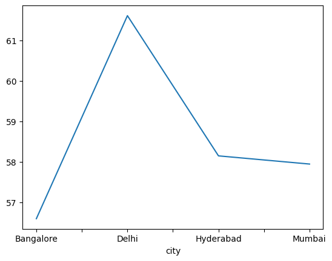
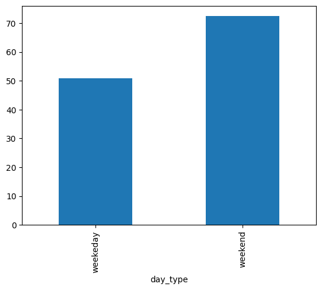
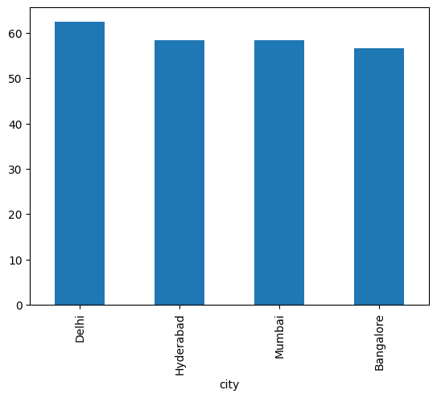
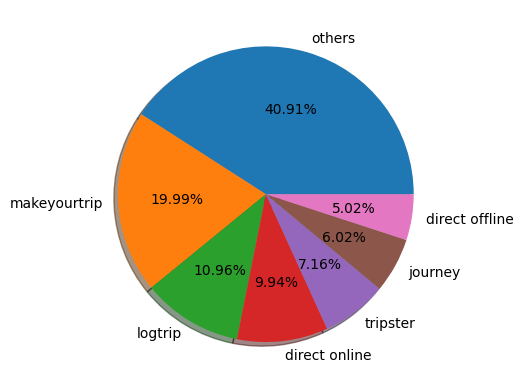

# AtliQ Hotels — Exploratory Data Analysis (EDA)

A practical Python EDA project exploring hotel bookings, occupancy, revenue, booking channels, and guest ratings. The goal is to turn booking data into useful questions hotel teams can investigate to improve performance.

> **Project note:** The analysis below reflects the results already present in the notebook. It is exploratory analysis, so the findings show patterns and possible opportunities—not proof that one factor caused another.

## At a glance

- **Tools:** Python, Pandas, Matplotlib, Jupyter Notebook
- **Analysis period:** The date dimension shown in the notebook covers May–July 2022; the notebook also appends a small August dataset.
- **Main themes:** Data cleaning, occupancy, city performance, weekend demand, realized revenue, room categories, booking platforms, and guest ratings.

## Business questions and what the data says

### 1. Which cities have the highest average occupancy?

**What the notebook found**

| City | Average occupancy |
|---|---:|
| Delhi | 61.61% |
| Hyderabad | 58.14% |
| Mumbai | 57.94% |
| Bangalore | 56.59% |

Delhi has the highest average occupancy in this analysis, while Bangalore is lowest.

**Why it matters:** Occupancy helps show how effectively available rooms are being filled. A lower rate can point to an opportunity to review demand, pricing, marketing, distribution channels, or the local competitive landscape.

**What I would do next:** Compare Bangalore properties by weekday, room class, booking lead time, and channel. Test targeted offers on weaker dates rather than discounting every room across the city.



### 2. Is occupancy stronger on weekends or weekdays?

**What the notebook found**

| Day type | Average occupancy |
|---|---:|
| Weekend | 72.39% |
| Weekday | 50.90% |

Weekend occupancy is about **21.49 percentage points higher** than weekday occupancy in the data analyzed.

**Why it matters:** Demand appears to be much stronger on weekends. That creates an opportunity to focus weekday campaigns on segments that may travel for work or other non-leisure reasons, while protecting revenue on busy weekends.

**What I would do next:** Review weekday demand by city and property. Test corporate packages, longer-stay offers, or weekday value-adds. Before launching a discount, compare average daily rate and revenue per available room (RevPAR) so that higher occupancy does not come at the cost of profitability.



### 3. Which cities performed best for occupancy in June?

**What the notebook found**

| City | June average occupancy |
|---|---:|
| Delhi | 62.47% |
| Hyderabad | 58.46% |
| Mumbai | 58.38% |
| Bangalore | 56.58% |

Delhi again leads, and Bangalore is lowest for June.

**Why it matters:** Looking at one month gives the team a more focused view than an overall average. It can help identify where to investigate local demand and whether a pattern persists across time.

**What I would do next:** Compare June with May and July, then break the results down to individual properties and room classes. The city average can hide hotels that are doing very well—or struggling badly—within the same city.



### 4. Which city generated the most realized revenue?

**What the notebook found**

| City | Realized revenue |
|---|---:|
| Mumbai | 668,569,251 |
| Bangalore | 420,383,550 |
| Hyderabad | 325,179,310 |
| Delhi | 294,404,488 |

Mumbai generated the highest total realized revenue in the analyzed booking records.

**Why it matters:** Total revenue is useful, but it should not be used alone to judge performance. A city with more rooms or a different room mix may naturally generate more revenue.

**What I would do next:** Compare revenue alongside room inventory, occupancy, average daily rate (ADR), and RevPAR. This would help distinguish strong pricing from simply having more rooms or more bookings.

### 5. Which booking platforms contribute to bookings and revenue?

The notebook examines booking counts by platform and visualizes realized revenue by platform. The booking-count output shows **“Others”** as the largest category, followed by **MakeYourTrip** and **Logtrip**.

**Why it matters:** Channel mix can affect acquisition costs, customer reach, and the amount of revenue retained after commissions. A large “Others” category can also make channel performance harder to interpret.

**What I would do next:**
- Split “Others” into named channels where possible.
- Compare each channel’s booking count, realized revenue, cancellation rate, and average booking value.
- Include commission or acquisition cost before deciding which channel is most profitable.
- Check whether channel performance differs by city, room class, and weekday/weekend.



### 6. Which room category has the highest occupancy?

The notebook calculates average occupancy by room category and also maps room codes to room classes. The category-level output reports RT4 at **59.30%**, compared with RT1 at **58.23%**, RT2 at **58.04%**, and RT3 at **58.03%**.

**Interpretation:** The differences in this output are relatively small. I would not recommend a major pricing or inventory decision based on these averages alone. The notebook's separate room-class grouping gives somewhat different figures, so this result should be validated by checking the merge and aggregation steps before being used in a business decision.

**What I would do next:** Calculate occupancy, ADR, and RevPAR by room class and property, then compare weekday and weekend demand. This can help determine whether room pricing or room availability needs to change.

### 7. What data-quality issues should be addressed before trusting the results?

The notebook identifies several issues and applies cleaning steps:

- Rows with zero or negative guest counts are removed.
- Very high `revenue_generated` values above a mean-plus-three-standard-deviations threshold are removed.
- Missing guest ratings are retained rather than filled with an artificial average.
- Two missing capacity values in the aggregated bookings data are filled using the column mean.
- Occupancy is calculated as successful bookings divided by capacity.

**A note of caution:** Outliers are not automatically errors. A high-value booking may be a genuine luxury-room reservation. It is safer to inspect those rows and confirm the business rules before removing them. Similarly, mean-imputing capacity may be acceptable for a quick exercise, but checking the source records is preferable.

The notebook also uses mixed date formats, so date parsing and validation should be consistent before rerunning the project.

## Practical recommendations

Based on these findings, I would prioritize the following investigations:

1. **Improve weekday occupancy:** Start with Bangalore and compare weekday performance at property level before testing targeted offers.
2. **Protect weekend revenue:** Weekend occupancy is already much higher, so check whether pricing can be optimized rather than applying broad discounts.
3. **Investigate channel profitability:** Booking volume and revenue are only part of the picture; add commission and acquisition costs.
4. **Compare properties fairly:** Use occupancy together with ADR and RevPAR, and account for room inventory and room mix.
5. **Strengthen data quality:** Validate outliers, missing capacities, date formats, and the room-category merge before presenting final KPIs.
6. **Track results over time:** Compare month-on-month trends and monitor whether changes actually improve revenue and profitability.

## Dataset and how to run

The notebook expects the following CSV files in its working directory:

- `dim_date.csv`
- `dim_hotels.csv`
- `dim_rooms.csv`
- `fact_aggregated_bookings.csv`
- `fact_bookings.csv`
- `new_data_august.csv`

These source CSVs were **not included with the uploaded notebook**, so they are not bundled here. Add them to the project only if you have the right to share them, or update the notebook to point to the dataset's permitted download location.

### Run locally

1. Install Python 3.10+ and Jupyter.
2. Install the libraries listed in `requirements.txt`.
3. Place the required CSV files where the notebook expects them, or update the file paths.
4. Open `Hotel_Analysis_EDA_project.ipynb` in Jupyter Notebook or VS Code and run the cells in order.

```bash
pip install -r requirements.txt
jupyter notebook Hotel_Analysis_EDA_project.ipynb
```

## Repository structure

```text
Hotel-Analysis-EDA/
├── Hotel_Analysis_EDA_project.ipynb
├── README.md
├── requirements.txt
├── .gitignore
└── screenshots/
    ├── booking_platform_distribution.png
    ├── average_occupancy_by_city.png
    ├── weekday_vs_weekend_occupancy.png
    ├── june_occupancy_by_city.png
    └── revenue_by_booking_platform.png
```

## Limitations

- The data shown is from a limited period, so it may not represent current demand or seasonality throughout the year.
- Total revenue is not the same as profitability; channel commission and operating costs are not included in the reported comparisons.
- The notebook's August append contains only seven rows and should not be treated as a full month of data.
- Recommendations are starting points for further analysis, not guaranteed performance improvements.

---

*Written in plain language to explain what the analysis means for hotel operations, not just what the Python code does.*
